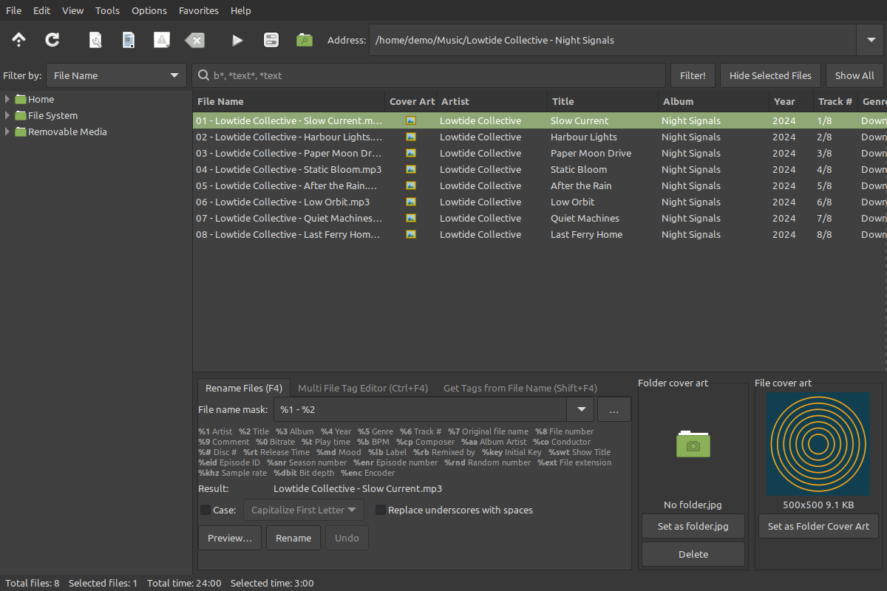

# Retag for Linux Mint


A music tag editor and file renamer. It uses Python 3 + GTK3 + mutagen + Pillow, all of which ship with Linux Mint.



## Install

Download the latest `.deb` from [Releases](https://github.com/donwildman/retag/releases) and run `sudo apt install ./retag_1.0.0_all.deb`.

## Run

```bash
./retag.py [folder]          # run in place
./build-deb.sh [version]     # build retag_<version>_all.deb (default 1.0.0)
sudo apt install ./retag_1.0.0_all.deb   # install; adds `retag` and a Sound & Video menu entry
/usr/bin/python3 test_tagcore.py   # core self-check (needs ffmpeg)
```

Settings live in `~/.config/Retag/Retag.ini` under `[Config]`, using the original's key names.

## Files

| File | What |
|---|---|
| `tagcore.py` | No GUI: tag read/write per format, masks, rename planning + undo, settings |
| `retag.py` | GTK3 app |
| `logo/` | App icon, 16 px icon, wordmark, lockup (SVG) |
| `test_tagcore.py` | Round-trips every field and cover art through mp3, flac, ogg, opus, m4a, wma, wav, aiff, wv; checks masks, parsing, collisions, undo |

## What's in

- Folder tree, address bar with history, favorites, search subfolders, file list with configurable/sortable/reorderable columns, filter (`b*`, `*text*`), hide selected, move up/down, random order.
- **Rename Files** (F4): masks with all spec variables, folders via `\` in the mask, case modes, word replacements, keep-case list, underscores→spaces, preview, ` (n)` collision suffix or skip, refusal on duplicate targets, one-batch undo.
- **Multi File Tag Editor** (Ctrl+F4) and the full **Tag Editor** (F5 / Ctrl+F5): every mapped field behind a write-checkbox, cover art (add/remove/save/drag-drop/web search), lyrics, Save and Prev/Next, Retry on save errors.
- **Get Tags from File Name** (Shift+F4) with `%d` skip and `\` path parts, plus preview.
- Rename Folder (F7), Edit File Name (F2/F6), Copy/Paste tag with paste exclusions, auto-fill track # (Ctrl+T).
- Folder/file cover panels and tools: add folder.jpg to tags, extract to folder.jpg, delete, resize.
- ID3 written as v2.3 (Latin-1 or UTF-16 per options), ID3v1 policy, Album Artist automation, year trimming, timestamp preservation.

## Licence

Copyright (C) 2026 Don Wildman. Free software under the GNU General Public License v3.0 or later; see `LICENSE`. Comes with no warranty.
